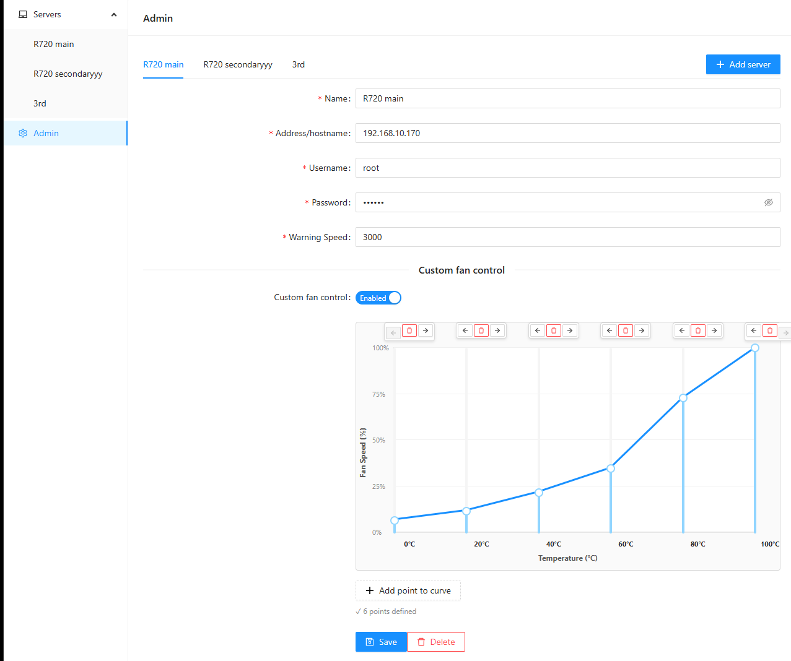

# Dell Server Monitor — T630 fan manager

A web app for monitoring Dell servers over IPMI and driving their fans from a custom curve. This is a fork of [Danielv123/serverManager](https://github.com/Danielv123/serverManager), reworked to run unattended on a PowerEdge T630 (iDRAC8).



## What it does

- Polls every configured iDRAC with `ipmitool sensor` (every 30 s by default) and shows power, temperature, fan and utilisation readings live in the browser.
- With **custom fan control** on, it takes the hottest temperature sensor, looks it up on your fan curve and sets every fan to that speed. With it off, the iDRAC's own automatic control is in charge.
- Exposes Prometheus metrics, a JSON status endpoint and a health check.

There is no authentication: keep it on a trusted network.

## How fan control behaves

**The curve.** The points of the curve are spaced evenly from 0 °C (first point) to 100 °C (last point), and the speed between two points is the straight line the editor draws. With 17 points they are 6.25 °C apart. The 2022 upstream image interpolated with a bug that overshot by up to 3.2× inside each segment, so on the same curve this version runs the fans somewhat slower at temperatures between points (for example 25 % instead of ~34 % at 49 °C on the T630 curve). Check temperatures under load once after upgrading and raise the curve if you want the old behaviour back.

**Hysteresis** (optional, °C): once the fans have sped up, they only slow down after the temperature has dropped this much, which stops them hunting up and down around a curve point.

**Manual mode is re-sent every poll.** The iDRAC drops back to automatic whenever it or the host restarts, and then silently ignores speed commands. The old version only enabled manual mode at startup, so after a reboot it kept logging speeds that never reached the fans.

**Failsafe: the fans are handed back to the iDRAC** (its automatic mode) when

- a temperature reaches its sensor's own upper warning threshold (CPU `Temp` on a T630: 90 °C), or the *Failsafe temperature* you configured if that is lower, or the iDRAC flags a temperature critical. The app takes over again once every temperature is 5 °C below its limit;
- the iDRAC reports no temperatures;
- three polls in a row fail (iDRAC unreachable, ipmitool timing out or crashing);
- the container stops (`docker stop`, redeploy) or the app crashes;
- you delete the server, or change its address or credentials (the old iDRAC is released first).

So the fans are never left pinned at a fixed speed with nothing watching the temperatures. While in failsafe the server shows a red **Failsafe** tag with the reason, and `/healthz` returns 503.

**Passwords** are passed to ipmitool through the `IPMI_PASSWORD` environment variable, never on a command line, and are never sent to the browser or written to logs. `servers.json` is written with mode 600.

## Deployment on t630 (GitOps)

The production stack is `docker-compose.yml`, deployed by **Portainer stack 8** (`t630-fan-manager`) on t630's local Portainer, which polls `master` of this repo.

1. A push that changes the app (`backend/`, `frontend/`, `Dockerfile`, the workflow) runs `.github/workflows/docker-publish.yml`: backend and frontend tests, an image build, a smoke test of the image, and a push to `ghcr.io/joshuawowk/t630-web-fan-manager` tagged `sha-<commit>` and `<branch>` (`latest` on master).
2. On `master` only, the **deploy** job then rewrites the `image:` line of `docker-compose.yml` to the new `sha-<commit>` tag and commits it as `Deploy sha-xxxxxxx to t630 [skip ci]`.
3. Portainer sees the new commit on its next poll and redeploys the stack.

So **a push to `master` is a production deploy.** Work on a branch: branch pushes build and publish an image (`:<branch>`) but never deploy. Because CI commits to `master`, `git pull --rebase` before pushing.

**Roll back** by reverting the latest `Deploy sha-…` commit (or editing `docker-compose.yml` to an older `sha-` tag) and pushing. The last known-good upstream image, pinned by digest, is
`ghcr.io/danielv123/servermanager@sha256:b8399fb2b1a067c2d8e6731b43daa739ce2593be3cbe8f34d1770b590c1c4009` — it still reads a `servers.json` written by this version. The first start of this version also keeps the original file as `servers.json.v1.bak`.

**Why not Alpine:** Alpine's `ipmitool` 1.8.19 segfaults part-way through `ipmitool sensor` on Dell iDRACs, before the CPU temperatures (upstream issue [#93](https://github.com/Danielv123/serverManager/issues/93); reproduced on the T630). The image is based on `node:24-trixie-slim` with Debian's `ipmitool`.

## Configuration

Servers, credentials and curves are edited in the web UI and stored in `/usr/src/app/data/servers.json` (mount a volume there). The process itself is configured with environment variables:

| Variable | Default | Meaning |
|---|---|---|
| `PORT` | `8080` | HTTP port |
| `POLL_INTERVAL_SECONDS` | `30` | How often each iDRAC is polled |
| `IPMI_TIMEOUT_SECONDS` | `20` | Kill an ipmitool call after this long |
| `FAILSAFE_READ_FAILURES` | `3` | Failed polls in a row before handing a server back to the iDRAC |
| `RESTORE_AUTO_ON_EXIT` | `true` | Hand fans back to the iDRAC when the app stops |
| `DRY_RUN` | `false` | Read sensors but never send fan commands |
| `DATA_DIR` | `data` | Where `servers.json` lives |
| `IPMITOOL_PATH` | `ipmitool` | ipmitool binary |

## Endpoints

| Path | |
|---|---|
| `/` | Web UI |
| `/api/status` | Servers, sensors and controller status as JSON (no passwords) |
| `/healthz` | 200 when healthy; 503 when the control loop has stalled, a server has not been read for 5 minutes, or a server is in failsafe. Used by the image's `HEALTHCHECK`. |
| `/metrics` | Prometheus: every sensor (`servermanager_statistics_gauge`), `servermanager_fan_target_percent`, `servermanager_control_temperature_celsius`, `servermanager_fan_control_mode`, `servermanager_ipmi_errors_total`, `servermanager_last_sensor_read_timestamp_seconds` |

The socket.io protocol between the UI and the backend is described in [docs/PROTOCOL.md](docs/PROTOCOL.md).

## Development

```sh
cd backend && npm ci && npm test        # unit tests plus an end-to-end run against a mock ipmitool
cd frontend && npm ci && npm test

# Backend in dev mode (port 8082, dry run) and the Vite dev server (port 3000, proxies socket.io to 8082)
cd backend && npm run dev
cd frontend && npm run dev

# Point the backend at the mock ipmitool instead of real hardware
IPMITOOL_PATH=$PWD/backend/test/mock-ipmitool.js npm run dev

# The production image, built locally
docker compose -f compose-dev.yml up -d --build
```

`compose.yml` is a minimal sample deployment for other hosts.

## Known working hardware

* T630 with iDRAC8 — monitoring + fan control (this fork's target)
* R720 with iDRAC7 - Monitoring + fan control
* R620 [#25](https://github.com/Danielv123/serverManager/issues/25)
* R710 with iDRAC6 [#3](https://github.com/Danielv123/serverManager/issues/3)
* R730XD idrac 8 Enterprise [#87](https://github.com/Danielv123/serverManager/issues/87)
* R520 [#77](https://github.com/Danielv123/serverManager/issues/77)
* T430 [#90](https://github.com/Danielv123/serverManager/issues/90)
